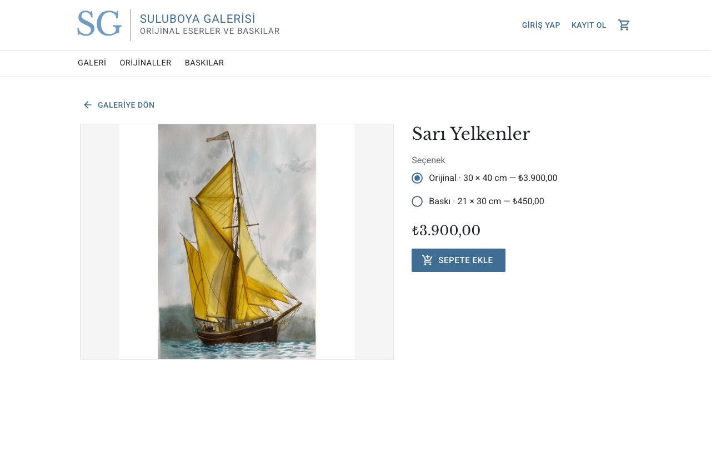
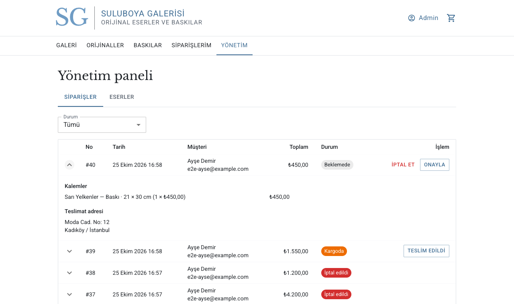
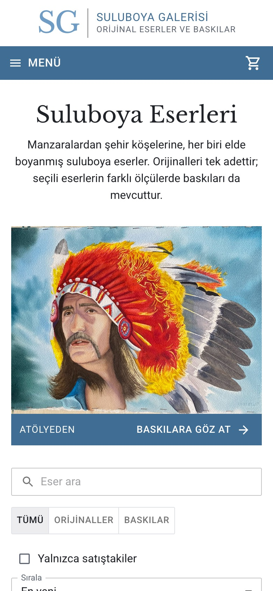

# Watercolor Portfolio

<p align="center">
  
</p>

A full-stack web shop for selling original watercolor paintings and their prints. Visitors browse the gallery, registered customers order originals or prints in different sizes, and the admin manages artworks, stock and order status.

Built with **React + TypeScript** on the frontend and **ASP.NET Core (.NET 10) + EF Core + PostgreSQL** on the backend. The user interface is in Turkish.

## Paintings

<p>
  
  
  
  
</p>

## Screenshots

| Gallery | Artwork detail |
|---|---|
|  |  |

| Admin: order management | Mobile |
|---|---|
|  |  |

<sub>Prices, orders and customers in the screenshots are demo data.</sub>

## Features

**Visitors**
- Gallery with search, type filter (originals / prints), "in stock only", price sorting and pagination; filters and page live in the URL, so a filtered view can be shared
- Artwork detail page with all purchase options (the original and prints in different sizes)

**Customers**
- Register and sign in (JWT)
- Cart stored in the browser; prices and stock are always re-read from the API
- Checkout with shipping address and card payment on iyzico's hosted payment page (3D Secure); order history and order detail
- Cancel an order while it is unpaid or still pending; a paid order is refunded and the stock goes back on sale

**Admin**
- Order list with status filter and pagination; orders move one step at a time: Pending → Confirmed → Shipped → Delivered, and can be cancelled (with refund) before shipping
- Live notification (SignalR) when a customer places or cancels an order; the order list refreshes by itself
- Create and edit artworks, upload images, and manage each artwork's purchase options (original and prints) with their own price and stock

## Technical highlights

- **Artworks and variants.** An artwork (title, description, image) has many variants: at most one `Original` and any number of `Print` sizes. Price, size and stock live on the variant, and order items point to a variant.
- **Rules enforced in the database too.** A filtered unique index allows only one original per artwork; check constraints keep stock non-negative and the original's stock at 0 or 1; a composite unique index prevents duplicate print sizes.
- **Safe stock handling.** Stock is decremented with a single conditional `UPDATE … WHERE Stock >= quantity` inside a transaction, so two customers cannot both buy the last original, and a multi-item order either succeeds completely or not at all.
- **Order snapshots.** Order items store the title, variant type, size and unit price at the time of purchase, so editing an artwork later does not change past orders.
- **Authentication and authorization.** ASP.NET Core Identity with JWT bearer tokens and `User` / `Admin` roles. Accounts lock for 15 minutes after 5 failed sign-ins, and the auth endpoints are rate limited per IP.
- **Image uploads.** File type is detected from the file's magic bytes rather than its name or `Content-Type`. Each upload is re-encoded with SkiaSharp into a 1600 px WebP and a 640 px thumbnail: phone photos are rotated according to their EXIF orientation, EXIF data such as GPS location is stripped, and oversized images are rejected. Files get random names, are served with `nosniff`, and storage sits behind an `IImageStorage` interface (local disk today, cloud storage later).
- **Payments without touching card data.** Checkout uses iyzico's hosted Checkout Form, so card numbers never reach this server. The result is always verified with iyzico's API rather than trusted from the browser, and the paid amount and basket are checked against the order. Orders wait in `AwaitingPayment` with their stock reserved; a background job cancels unpaid orders after 30 minutes, but first asks iyzico whether the payment actually went through, so a customer who paid and closed the browser is not cancelled. Cancelling a paid order refunds it (full cancel on the same day, per-item refunds after). The gateway sits behind an `IPaymentGateway` interface; in development without iyzico keys a local test payment page is used instead.
- **Cancellation without double refunds.** The status check and the switch to `Cancelled` happen in one conditional `UPDATE`, so a customer and an admin cancelling at the same moment return the stock only once.
- **Real-time admin notifications.** An admin-only SignalR hub authenticates with the same JWT (passed as `access_token` for WebSockets); a failed notification never fails the order itself.
- **REST API design.** Nested resources (`/api/artworks/{id}/variants`), query-string filtering and sorting, pagination on admin orders, and `ProblemDetails` error responses.
- **Data migration.** Moving from per-artwork prices to variants was done with a hand-written EF Core migration that copies existing data before dropping the old columns.

## Tech stack

| Layer | Technologies |
|---|---|
| Frontend | React 19, TypeScript, Vite, Material UI, React Router, SignalR client |
| Backend | ASP.NET Core Web API (.NET 10), Entity Framework Core 10, ASP.NET Core Identity, JWT, SignalR, SkiaSharp |
| Payments | iyzico (Checkout Form, sandbox) |
| Database | PostgreSQL (Npgsql) |

## Project structure

```
backend/
  Watercolor.Api/
    Controllers/     REST endpoints (artworks, variants, orders, admin orders, auth)
    Models/          EF Core entities
    Data/            DbContext, model configuration, role/admin seeding
    Dtos/            Request and response contracts
    Auth/            JWT token service, roles, rate-limit policy
    Storage/         Image storage, file type detection, resizing
    Services/        Order cancellation
    Payments/        Payment gateway (iyzico + development test page), payment flow, expiry job
    Hubs/            SignalR hub for admin notifications
    Migrations/      EF Core migrations
frontend/
  src/
    api/             Typed API client
    auth/            Session state and storage
    cart/            Cart state
    components/      Shared UI (header, cards, protected route…)
    pages/           Public, customer and admin pages
docs/screenshots/    Screenshots used in this README
```

## Getting started

### Prerequisites

- [.NET 10 SDK](https://dotnet.microsoft.com/download)
- [Node.js 24 LTS](https://nodejs.org/)
- PostgreSQL 16 or newer (on macOS, [Postgres.app](https://postgresapp.com/) is the simplest option)

### 1. Database

Create an empty database:

```bash
createdb -U postgres watercolor
```

The development connection string is in `backend/Watercolor.Api/appsettings.Development.json`:

```
Host=localhost;Port=5432;Database=watercolor;Username=postgres
```

Adjust it if your PostgreSQL user or password differs.

### 2. Secrets

The JWT signing key and the initial admin account are kept out of the repository with [user secrets](https://learn.microsoft.com/aspnet/core/security/app-secrets):

```bash
cd backend/Watercolor.Api
dotnet user-secrets set "Jwt:Key" "<random string, at least 32 characters>"
dotnet user-secrets set "AdminUser:Email" "admin@example.com"
dotnet user-secrets set "AdminUser:Password" "<strong password>"
```

The admin password must contain upper- and lowercase letters, a digit and a symbol, and be at least 6 characters long. The roles and the admin account are created automatically on first start.

For payments, create a free [iyzico sandbox](https://sandbox-merchant.iyzipay.com/) account and add its keys:

```bash
dotnet user-secrets set "Iyzico:ApiKey" "<sandbox api key>"
dotnet user-secrets set "Iyzico:SecretKey" "<sandbox secret key>"
```

Without these keys the development environment falls back to a local test payment page with "approve" and "reject" buttons, so the whole order flow still works. Outside development the keys are required.

### 3. Backend

```bash
cd backend
dotnet tool restore
dotnet ef database update --project Watercolor.Api
cd Watercolor.Api
dotnet run
```

The API runs at `http://localhost:5216`. In development, the OpenAPI document is available at `/openapi/v1.json`, and `Watercolor.Api.http` contains ready-made requests.

### 4. Frontend

```bash
cd frontend
npm install
npm run dev
```

Open `http://localhost:5173`. The Vite dev server proxies `/api`, `/uploads` and the `/hubs` WebSocket to the backend.

## API overview

| Method | Endpoint | Access |
|---|---|---|
| `GET` | `/api/artworks?search=&type=&inStock=&sort=&page=&pageSize=` | Public |
| `GET` | `/api/artworks/{id}` | Public |
| `POST` `PUT` `DELETE` | `/api/artworks`, `/api/artworks/{id}` | Admin |
| `POST` `DELETE` | `/api/artworks/{id}/image` | Admin |
| `POST` `PUT` `DELETE` | `/api/artworks/{id}/variants`, `/api/artworks/{id}/variants/{variantId}` | Admin |
| `POST` | `/api/auth/register`, `/api/auth/login` | Public (rate limited) |
| `GET` | `/api/auth/me` | Signed in |
| `GET` `POST` | `/api/orders` | Signed in (own orders) |
| `GET` | `/api/orders/{id}` | Owner or admin |
| `POST` | `/api/orders/{id}/payment` | Owner (returns the payment page URL) |
| `POST` | `/api/orders/{id}/cancel` | Owner (unpaid or pending orders) |
| `POST` | `/api/payments/callback` | Payment provider redirect (form post) |
| `GET` | `/api/admin/orders?status=&page=&pageSize=` | Admin |
| `PATCH` | `/api/admin/orders/{id}/status` | Admin (including `Cancelled`) |
| WebSocket | `/hubs/admin` (`OrderCreated`, `OrderCancelled`) | Admin |

## Roadmap

- Live iyzico account (requires a registered business)
- Refresh tokens
- Email notifications to customers
- Deployment with HTTPS
